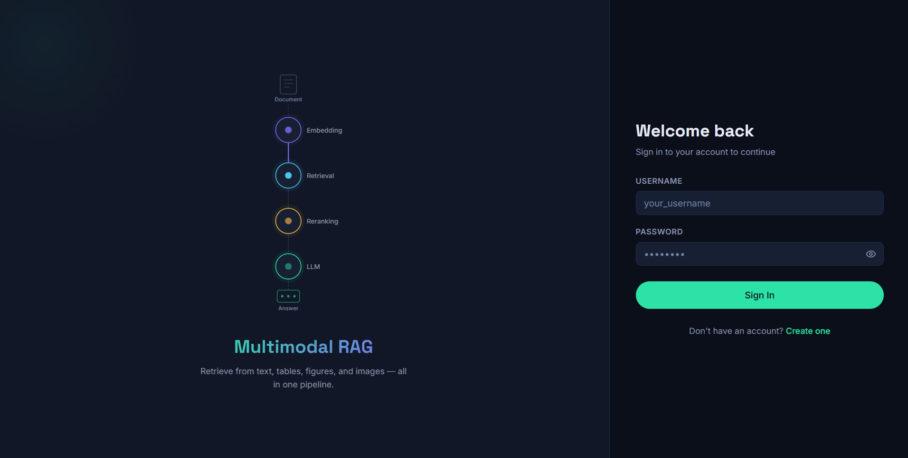
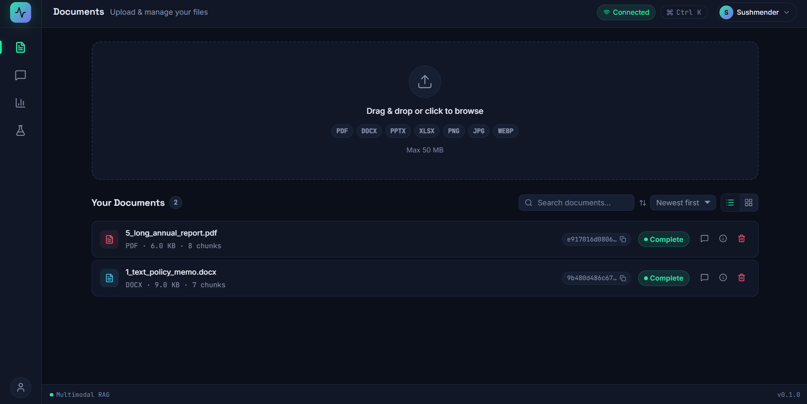
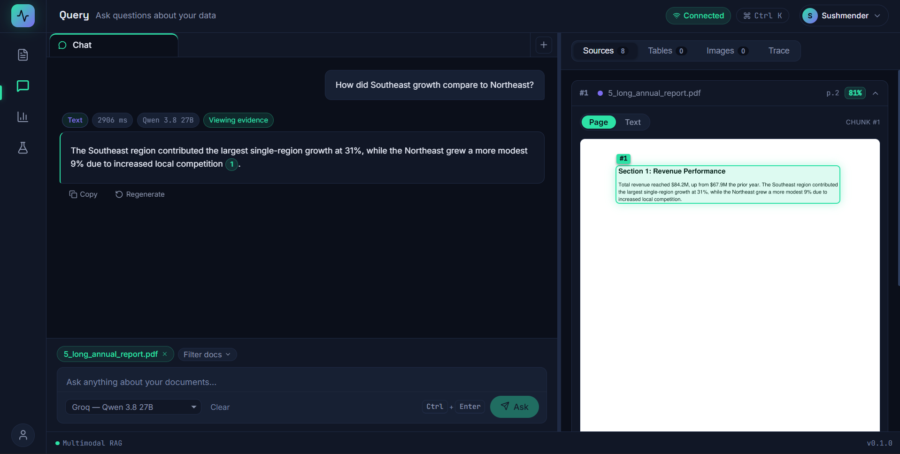
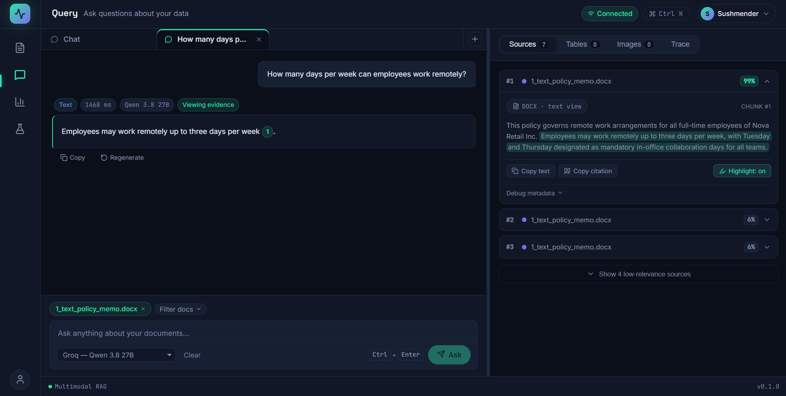
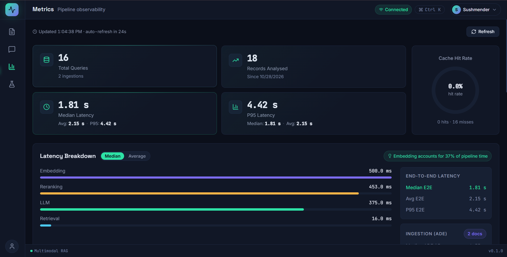
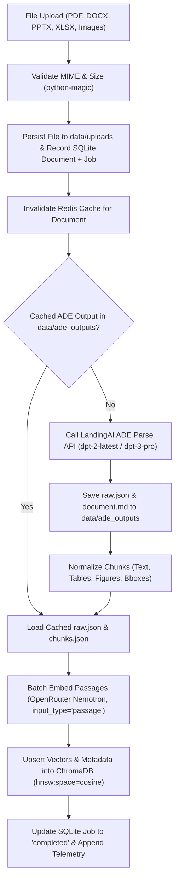
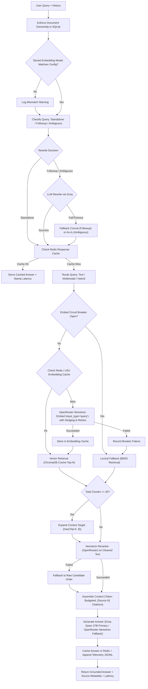

# Multimodal RAG Platform

A production-oriented Retrieval-Augmented Generation (RAG) system engineered for visual and structured document comprehension. The platform parses complex documents (PDF, DOCX, PPTX, XLSX, and images) into layout-aware text, table, and figure chunks with bounding-box coordinates via LandingAI ADE, indexes them using NVIDIA multimodal embeddings in ChromaDB, and delivers grounded, verifiable answers through Groq and OpenRouter LLMs with per-user scoping and end-to-end observability.

- **Multimodal Document Understanding**: Vision-based parsing of PDFs, Office documents, and images preserving layout, tables, and bounding boxes via LandingAI ADE.
- **Resilient Hybrid Retrieval**: Cosine vector search with transparent BM25 lexical fallback when embedding providers experience downtime or rate limits.
- **Contextual Follow-up Rewriting**: Deterministic classifier paired with LLM rewriting to resolve pronouns and references into standalone queries before retrieval.
- **Visual Grounding and Overlays**: Citations map directly to rendered PDF and image pages with highlighted bounding boxes and interactive zoom controls.
- **Production Defense Layers**: Request hedging, exponential retry backoff, two-tier embedding cache (Redis + in-memory LRU), and an in-process circuit breaker.
- **Isolated Multi-Session Chat**: Independent conversation tabs with dedicated histories, query routing, and per-user scoped Redis response caching.
- **Full-Spectrum Observability**: Append-only JSONL telemetry tracking per-stage latency percentiles (P50/P95), token usage, and dollar costs.
- **Automated RAG Benchmarking**: In-app evaluation suite computing pre- and post-rerank Recall@K and Precision@K against a gold test dataset.

---

## Screenshots

| View | Preview | Description |
|---|---|---|
| **Login** |  | JWT-based user authentication and account registration interface. |
| **Documents** |  | Upload center tracking async ingestion status, chunk metrics, and ADE credits. |
| **Query & Citations** |  | Grounded answers with inline citation chips and interactive page bounding-box viewer. |
| **Chat Tabs** |  | Multi-tab chat workspace maintaining independent context and conversation sessions. |
| **Observability** |  | Telemetry dashboard displaying stage latency breakdowns, cache hit rate, and query logs. |

---

## Architecture

### Ingestion Pipeline


### Query Pipeline


### Data Storage and User Scoping
- **SQLite (`data/rag.db`)**: Relational store for `users` (credentials), `documents` (metadata, parse metrics), and `jobs` (async ingestion state machine).
- **ChromaDB (`data/chroma_db/`)**: Embedded vector store holding chunk embeddings, bounding boxes (`bbox_x0`, `bbox_y0`, `bbox_x1`, `bbox_y1`), page numbers, and embedding model versions with cosine distance.
- **Redis**: Fast caching tier for query-answer pairs (`user:{user_id}:qa:...` hashes with 1h TTL) and query embeddings (`embed_cache:...` with 24h TTL and in-memory LRU fallback).
- **Telemetry (`data/telemetry.jsonl`)**: Append-only log recording stage latencies, token consumption, ADE credits, and dollar costs.
- **Disk Storage**: Uploaded files stored in `data/uploads/`; intermediate ADE artifacts (`raw.json`, `document.md`, `chunks.json`) in `data/ade_outputs/{document_id}/`.
- **Per-User Scoping**: Every protected endpoint authenticates via JWT. SQLite queries, vector search, BM25 fallback, Redis cache, telemetry metrics, and evaluations are strictly isolated to the caller's `user_id`.

---

## Tech Stack

| Layer | Component | Description |
|---|---|---|
| **Backend** | Python 3.12, FastAPI 0.115.0, Uvicorn 0.30.6 | Asynchronous REST API framework |
| **Database** | SQLite via aiosqlite 0.20.0 | Async relational metadata and job persistence |
| **Vector Store** | ChromaDB 0.5.15 | Embedded persistent vector database with cosine indexing |
| **Caching** | Redis 5.1.0 (Upstash compatible) | Two-tier query response and vector embedding cache |
| **Document Parsing** | LandingAI ADE (`landingai-ade` 1.18.0) | Vision-based layout parsing and bounding-box extraction |
| **Rendering** | PyMuPDF (`pymupdf` 1.28.2) | In-memory PDF page image rendering for bbox visual overlays |
| **AI Models** | OpenRouter & Groq | NVIDIA Nemotron embedding/reranker/LLM and Groq Qwen3.8-27B |
| **Resilience** | Tenacity 9.0.0 & In-Process Breaker | Retries with backoff, request hedging, and circuit breaker |
| **Observability** | Structlog 24.4.0 & Aiofiles 24.1.0 | Structured JSON logging and non-blocking telemetry append |
| **Frontend** | React 19.2.8, Vite 8.3.0, React Router 7.18.3 | Single-page application with client-side routing |
| **UI Components** | Lucide React, Framer Motion, Recharts | Interactive charts, collapsible panels, and accessible modals |
| **Code Quality** | Ruff 0.6.9 & Oxlint 1.81.0 | Static analysis and linting for backend and frontend |

---

## Project Structure

```
Agentic_RAG/
├── backend/                  # FastAPI backend service
│   ├── app/                  # Core, API routes, database, providers, services
│   ├── data/                 # Persistent storage (SQLite, ChromaDB, uploads, ADE outputs, telemetry) [gitignored]
│   ├── sample_docs/          # Curated test files (PDF reports, Word documents)
│   ├── scripts/              # Diagnostic utilities (consistency check, embedding diagnostics, rewrite smoke tests)
│   ├── tests/                # Test suite (unit, integration, pipeline resilience, user scoping)
│   ├── Makefile              # Development task automation (dev, test, lint, install)
│   ├── requirements.txt      # Pinned Python dependencies
│   └── run.py                # Server launcher script with host, port, reload options
├── docs/                     # Documentation and architecture guides
│   ├── archive/              # Historical planning notes and transcripts (reference only)
│   ├── screenshots/          # Application walkthrough screenshot assets
│   ├── DEMO.md               # Evaluator demonstration walkthrough script
│   ├── multimodal_rag_basic_architecture.md   # System architecture reference
│   └── multimodal_rag_implementation_brief.md # Technical implementation brief
├── frontend/                 # React single-page application
│   ├── public/               # Static assets
│   ├── src/                  # React source (pages, components, context, hooks, services, utils)
│   ├── package.json          # Node dependencies and build scripts
│   └── vite.config.js        # Vite bundler configuration
└── README.md                 # Primary project documentation
```

---

## Getting Started

### Prerequisites
- **Python**: Version 3.12+ (tested with Python 3.12.9)
- **Node.js**: Version 20+ (tested with Node 24.16.0) and `npm`
- **External Accounts**:
  - [LandingAI ADE](https://landing.ai/): Layout-aware document parsing and bounding-box extraction.
  - [OpenRouter](https://openrouter.ai/): NVIDIA Nemotron embeddings, reranking, and fallback LLM.
  - [Groq](https://groq.com/): High-speed primary LLM generation (`qwen/qwen3.8-27b`).
  - [Upstash Redis](https://upstash.com/): Serverless Redis caching (optional; falls back to in-memory LRU if omitted).

### Setup and Execution

1. **Backend Setup** (PowerShell, or `source .venv/bin/activate` on bash):
   ```powershell
   cd backend
   python -m venv .venv
   .venv\Scripts\Activate.ps1
   pip install -r requirements.txt
   cp .env.example .env
   # Add your LANDINGAI_API_KEY, OPENROUTER_API_KEY, and GROQ_API_KEY to .env
   make dev
   ```
2. **Frontend Setup**:
   ```powershell
   cd frontend
   npm install
   cp .env.example .env
   npm run dev
   ```

| Service | URL | Purpose |
|---|---|---|
| Frontend Web UI | `http://localhost:5173` | Interactive React workspace |
| Backend API | `http://127.0.0.1:8000` | REST API service |
| Interactive API Docs | `http://127.0.0.1:8000/docs` | Swagger OpenAPI specification |
| ReDoc Documentation | `http://127.0.0.1:8000/redoc` | Alternative API reference |

### First Use Walkthrough
1. Open `http://localhost:5173/` and click **Create one** to register an account.
2. Navigate to **Documents** (`/documents`) and upload a sample file from `backend/sample_docs/pdf/` or `backend/sample_docs/word/`.
3. Wait for the status indicator to transition from `pending` -> `processing` -> `completed`.
4. Open **Query** (`/query`), submit a question, and click citation chips (`[Source 1]`) to inspect highlighted bounding boxes on the page.
5. Refer to [docs/DEMO.md](docs/DEMO.md) for a scripted 5-step evaluation walkthrough.

---

## Configuration

Settings are managed via environment variables and loaded from `.env` files.

### Backend Variables

| Scope | Variable | Default / Placeholder | Description |
|---|---|---|---|
| **Required** | `LANDINGAI_API_KEY` | *(empty string)* | LandingAI ADE API key for document parsing |
| **Required** | `OPENROUTER_API_KEY` | *(empty string)* | OpenRouter key (embeddings, reranker, fallback LLM) |
| **Required** | `GROQ_API_KEY` | *(empty string)* | Groq API key for primary LLM inference |
| **Required** | `JWT_SECRET_KEY` | `dev-secret-key-change-in-prod` | Secret signing key for JWT tokens |
| **Optional** | `HOST` | `127.0.0.1` | Network interface binding for uvicorn server |
| **Optional** | `PORT` | `8000` | TCP port for uvicorn server |
| **Optional** | `RELOAD` | `true` | Enable hot-reloading in development |
| **Optional** | `REDIS_URL` | `redis://localhost:6379` | Redis connection URL (`rediss://` for Upstash TLS) |
| **Optional** | `CACHE_TTL_SECONDS` | `3600` | TTL in seconds for cached query-answer pairs |
| **Optional** | `PRIMARY_LLM_MODEL` | `qwen/qwen3.8-27b` | Primary generation model on Groq |
| **Optional** | `FALLBACK_LLM_MODEL`| `nvidia/nemotron-3-super-120b-a12b:free` | Fallback generation model on OpenRouter |
| **Optional** | `EMBEDDING_MODEL` | `nvidia/nemotron-3-embed-1b:free` | Asymmetric passage/query embedding model |
| **Optional** | `RERANKER_MODEL` | `nvidia/llama-nemotron-rerank-vl-1b-v2:free` | Cross-encoder reranking model |
| **Optional** | `CHROMA_DB_PATH` | `./data/chroma_db` | Persistent storage directory for ChromaDB |
| **Optional** | `SQLITE_DB_PATH` | `./data/rag.db` | File path for SQLite relational database |
| **Optional** | `TELEMETRY_PATH` | `./data/telemetry.jsonl` | File path for append-only telemetry records |
| **Optional** | `UPLOAD_DIR` | `./data/uploads` | Directory for raw uploaded files |
| **Optional** | `ADE_OUTPUT_DIR` | `./data/ade_outputs` | Directory for ADE parser artifacts |
| **Optional** | `RETRIEVAL_TOP_N` | `20` | Candidate chunk retrieval limit |
| **Optional** | `RERANK_TOP_K` | `5` | Top reranked chunks supplied to LLM context |
| **Optional** | `SMALL_DOC_CHUNK_LIMIT` | `40` | Chunk threshold for small-document context expansion |
| **Optional** | `SMALL_DOC_CONTEXT_CHUNKS` | `8` | Target context chunks for small documents |
| **Optional** | `MAX_CONTEXT_TOKENS`| `8000` | Maximum token ceiling for prompt context assembly |
| **Optional** | `REWRITE_ENABLED` | `true` | Enable conversational follow-up rewriting |
| **Optional** | `REWRITE_TIMEOUT_S` | `2.5` | Timeout for follow-up rewriting before concat fallback |
| **Optional** | `EMBED_QUERY_TIMEOUT_S` | `4.0` | Timeout for query embedding requests |
| **Optional** | `EMBED_QUERY_HEDGE_AFTER_S` | `1.5` | Delay before launching concurrent hedged embedding call |
| **Optional** | `LOG_CONTEXT_DEBUG`| `false` | Enable verbose logging of reranked and prompt chunks |
| **Optional** | `RUN_LIVE_TESTS` | `0` | Set to `1` to run tests calling live external APIs |

### Frontend Variables

| Variable | Default | Description |
|---|---|---|
| `VITE_API_BASE_URL` | `http://localhost:8000/api/v1` | Base URL of the backend REST API |

> [!IMPORTANT]
> The backend binds strictly to `127.0.0.1` by default to prevent unintended network exposure. Set `HOST=0.0.0.0` explicitly only when hosting on a secured internal network. Keep all API keys in `.env` files; `.env` is strictly excluded by `.gitignore`.

---

## Using the Application

- **Documents**: Upload documents (PDF, DOCX, PPTX, XLSX, image formats). Displays real-time status transitions, parser version, chunk count, and ADE credits. Deleting a document removes its metadata from SQLite, chunks from ChromaDB, cached responses from Redis, and files from disk.
- **Query Workspace**: Multi-tab interface allowing distinct query threads. Generates markdown responses containing interactive `[Source N]` citations with relevance scores.
- **Visual Evidence Viewer**: Clicking citations opens the exact document page image with highlighted bounding boxes for PDFs and images. For office formats (DOCX/PPTX/XLSX), the viewer displays formatted chunk text with matched terms highlighted.
- **Follow-up Handling**: The query rewriter detects conversational follow-ups (e.g. *"What about its operating margins?"*) and transforms them into standalone questions using conversation history. If the rewriter fails or times out, it gracefully falls back to query concatenation.
- **Metrics Dashboard**: Displays pipeline metrics computed from `data/telemetry.jsonl` (P50/P95 latencies per stage, token usage, costs, cache hit rate) with timeframe filters (Today, Yesterday, This week).
- **Evaluation Runner**: Benchmarks retrieval quality by computing pre- and post-rerank Recall@K and Precision@K against `data/gold_dataset.json`.

### Keyboard Shortcuts

| Shortcut | Action | Scope |
|---|---|---|
| `Ctrl + K` / `Cmd + K` | Open command palette | Global |
| `?` | Display keyboard shortcuts modal | Global |
| `/` | Focus query input field | Global |
| `Ctrl + Enter` / `Cmd + Enter` | Submit query | Query input |
| `Alt + N` | Open a new chat tab | Global |
| `Alt + W` | Close current chat tab (except default) | Global |
| `Alt + 1` .. `Alt + 9` | Jump directly to chat tab 1 through 9 | Global |
| `Alt + ←` / `Alt + →` | Switch to previous / next chat tab | Global |
| `F2` | Rename active chat tab | Global |
| `G` then `D` | Navigate to Documents page | Global sequence |
| `G` then `Q` | Navigate to Query page | Global sequence |
| `G` then `M` | Navigate to Metrics page | Global sequence |
| `G` then `E` | Navigate to Evaluation page | Global sequence |
| `Escape` | Close modal dialog or command palette | Dialogs |

---

## API Overview

All routes are prefixed under `/api/v1`.

| Method | Endpoint | Auth | Description |
|---|---|---|---|
| `GET` | `/health` | No | System health check (ChromaDB, Redis, boot ID, embedding model mismatch) |
| `HEAD` | `/health` | No | Lightweight uptime ping |
| `POST` | `/auth/register` | No | Register new user account |
| `POST` | `/auth/login` | No | Form-data authentication returning JWT Bearer token |
| `POST` | `/documents/upload` | Yes | Upload document for async ingestion (returns document_id and job_id) |
| `GET` | `/documents/` | Yes | List all documents owned by authenticated user |
| `GET` | `/documents/{id}` | Yes | Retrieve document metadata and processing status |
| `GET` | `/documents/{id}/chunks/{chunk_id}` | Yes | Fetch single chunk text and bounding box from ChromaDB |
| `GET` | `/documents/{id}/pages/{page}/image` | Yes | Render PDF page to PNG or serve original image |
| `DELETE` | `/documents/{id}` | Yes | Delete document, ChromaDB vectors, cache entries, and local files |
| `GET` | `/jobs/{job_id}` | Yes | Poll async ingestion job progress and status |
| `POST` | `/query` | Yes | Execute full RAG pipeline (rewrite, cache, embed, retrieve, rerank, generate) |
| `GET` | `/query/history` | Yes | List cached Q&A pairs for the authenticated user |
| `GET` | `/metrics` | Yes | Retrieve aggregated pipeline telemetry and recent query traces |
| `GET` | `/evaluation/run` | Yes | Run Recall@K / Precision@K evaluation against gold dataset |

---

## Reliability and Performance Notes

- **Free-Tier Provider Resilience**: Free-tier inference providers (Groq and OpenRouter) experience periodic cold starts, rate limits (HTTP 429), and transient failures.
- **Query Embedding Safeguards**:
  - Request timeout of 4.0s (`EMBED_QUERY_TIMEOUT_S`) with 2 retry attempts and exponential backoff.
  - Hedging: If a query embedding request exceeds 1.5s (`EMBED_QUERY_HEDGE_AFTER_S`), a second concurrent request is initiated, taking whichever finishes first.
  - Two-tier caching: Query embeddings are cached in Redis (24-hour TTL) and local in-memory LRU (256 entries).
  - Circuit Breaker: Trips to `OPEN` on 2 consecutive failures within 60s, bypassing provider calls for 60s before allowing a single probe in `HALF_OPEN`.
  - Transparent Lexical Fallback: If query embedding fails or the circuit breaker is open, retrieval automatically switches to pure Python BM25 (`lexical_retrieve`). The API sets `"retrieval_mode": "lexical_fallback"`, `"degraded": true`, and the UI displays a "Keyword search" chip.
- **Response Caching**: Successful query answers are cached in Redis for 1 hour (`CACHE_TTL_SECONDS = 3600`).
- **Observed Dev Latencies** *(observed on local dev machine with free-tier providers; not guaranteed)*:
  - Cache hits: ~5 ms – 25 ms
  - End-to-end vector queries: ~1.2 s – 3.5 s
  - Degraded keyword fallback queries: ~0.8 s – 2.0 s

---

## Embedding Model Configuration

The configured embedding model (`nvidia/nemotron-3-embed-1b:free`) is **asymmetric**:
- Passages are embedded using `input_type="passage"` during document ingestion.
- Queries are embedded using `input_type="query"` during retrieval.

> [!WARNING]
> Document chunks and user queries must use the exact same embedding model. Modifying `EMBEDDING_MODEL` in `.env` renders existing vector coordinates in ChromaDB incompatible. If the embedding model is changed, all documents must be re-ingested. The backend records the model name in ChromaDB collection metadata, emits a warning log on startup and query execution if a discrepancy exists, and flags `"embedding_model_mismatch": true` in `GET /api/v1/health`.

---

## Testing and Verification

### Backend Test Suite
The backend test suite is built with `pytest` and `pytest-asyncio`. Run it from `backend/`:
```powershell
make test
# Or directly:
.venv\Scripts\pytest tests/ -v
```
- **Offline Isolation**: Tests execute completely offline using isolated temporary directories and mocks for LandingAI, OpenRouter, Groq, and Redis. The suite never alters local `backend/data/` files or calls external APIs.
- **Opt-in Live Tests**: Tests tagged with `@pytest.mark.live` verify end-to-end integration against real external APIs. Run live tests explicitly with:
  ```powershell
  $env:RUN_LIVE_TESTS="1"; .venv\Scripts\pytest tests/ -m live -v
  ```
  *(Live tests consume real API credits and require valid credentials in `.env`)*.

### Code Quality and Frontend Checks
- **Backend Linting**: `make lint` (runs `ruff check app/ tests/` inside `.venv`)
- **Frontend Linting**: `npm run lint` (runs fast Oxlint analysis)
- **Frontend Build**: `npm run build` (validates JSX compilation and compiles production bundle to `dist/`)

---

## Security and Data Privacy

- **Authentication**: JWT access tokens signed with `HS256` (`JWT_ACCESS_TOKEN_EXPIRE_MINUTES = 60`). Passwords hashed with `bcrypt`.
- **Tenant Isolation**: Every database row, vector chunk metadata item, Redis cache key, and telemetry log contains a `user_id`. Queries and evaluations cannot access documents owned by other accounts.
- **Network Boundaries**: Server defaults to `127.0.0.1` binding to avoid exposing endpoints without explicit configuration.
- **Data Persistence**: `backend/data/` contains all SQLite databases, vector indexes, uploaded files, and parsed artifacts, and is excluded from source control via `.gitignore`.
- **Backup Caution**: Always stop the backend server process before creating copies or backups of `backend/data/` to prevent copying database files during active WAL checkpointing.

---

## Known Limitations

- **Free-Tier Variability**: Response times and rate limits fluctuate based on upstream availability of free NVIDIA and Groq models.
- **Visual Overlays on Non-PDF Documents**: Bounding-box image overlays require PDF or native image uploads (rendered via PyMuPDF). DOCX, PPTX, and XLSX files provide text match highlights rather than rendered page overlays.
- **Evaluation Dataset Requirement**: `data/gold_dataset.json` is gitignored. On a fresh repository clone with no ingested documents, navigating to `/evaluation` displays an empty state. Once documents are uploaded, the evaluator auto-generates questions based on indexed chunks. Custom gold datasets must adhere to the format:
  ```json
  [
    {
      "question": "What was total revenue in Q4?",
      "expected_document_ids": ["<doc_id>"],
      "expected_chunk_ids": ["<chunk_id>"]
    }
  ]
  ```
- **Frontend Test Automation**: The frontend repository does not currently include automated browser integration test suites (Cypress/Playwright); build integrity is enforced via `oxlint` and `vite build`.

---

## Utility Scripts and Documentation

| File | Type | Description |
|---|---|---|
| `backend/scripts/check_embed_consistency.py` | Script | Read-only verification comparing stored vectors against current embedding model |
| `backend/scripts/diag_embed.py` | Script | Diagnostic script testing live embedding latency and error handling |
| `backend/scripts/try_rewrite.py` | Script | Manual smoke test evaluating follow-up query rewriting against live Groq LLM |
| `docs/DEMO.md` | Guide | Complete 5-step demonstration walkthrough for reviewers |
| `docs/multimodal_rag_basic_architecture.md` | Guide | Detailed technical architectural design document |
| `docs/multimodal_rag_implementation_brief.md` | Guide | Initial engineering implementation specification |
| `docs/archive/` | Directory | Historical design notes, transcripts, and development tasks (reference only) |
| `docs/screenshots/` | Directory | Application walkthrough screenshot assets |
